# Mountagent Desk

Every coding agent, one desk.

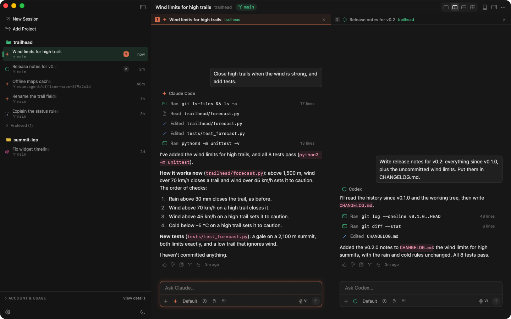

Mountagent Desk runs Claude Code, Codex, Cursor, GitHub Copilot, Antigravity, Gemini CLI and
OpenCode in one native macOS window. It drives each agent's own CLI, signed in with your own
account, so it costs nothing beyond the plans you already have. Kiro, Amp, Kimi Code, Grok
Build, Mistral Vibe, Droid or any other command run as terminal sessions beside them.

Each session can work in a git worktree of its own, and any turn can be undone. ⌘K jumps to a
session, ⌘T starts one on a new branch. Chats that aren't about a folder go in General, or in
a project made from a name alone.

Git is built in: changes, history, comments on the diff that go straight to the agent, a pull
request in one click, and cloning as in GitHub Desktop.

The app shows each agent's plan limits, when they reset, and when they would run out at the
current pace. It warns once a limit passes 90%, and when an agent runs out mid-turn, the next
one carries on with the conversation so far.

Servers open as terminals in their project. Agents can't reach them, except read-only on the
servers where you turn that on.

Claude Code and Codex can each have several accounts. A session picks one, and when it runs
out, another account takes over before another agent does. A session can also carry on by
itself once the limit resets, and schedules can run then. Mission Control (⇧⌘M) shows every
session that needs a look, and ⌘T sends one prompt to several agents side by side.

Mountagent Desk has no server of its own and no telemetry. Besides the agents themselves, it
talks only to GitHub, to Cursor's usage service when you turn its meters on, and to Lemon
Squeezy to activate a bought licence and check it once a week.

<b>More screenshots</b>

| | |
|---|---|
| **Undo any turn** 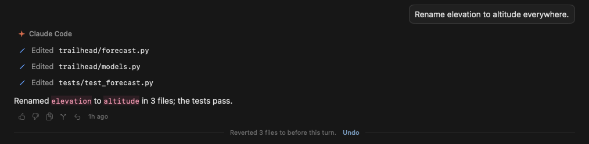 | **⌘K to any session** 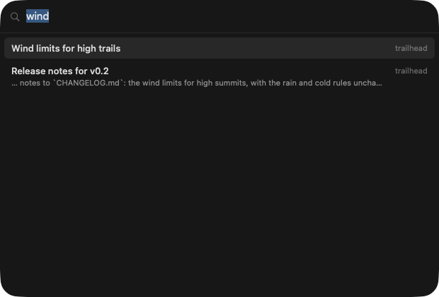 |
| **Prompts on `/`** 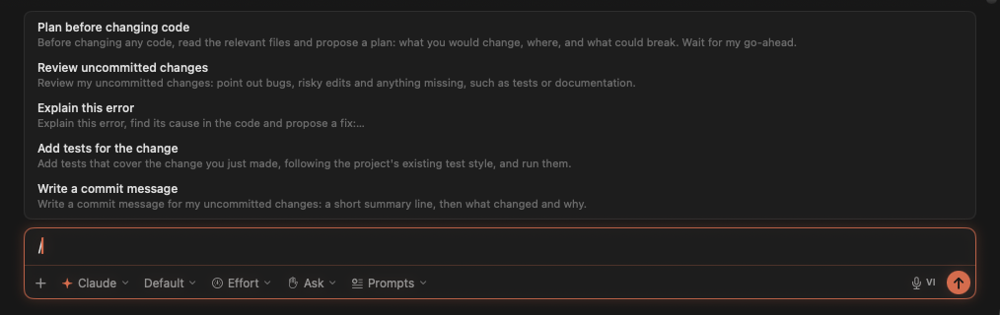 | **A worktree per session** 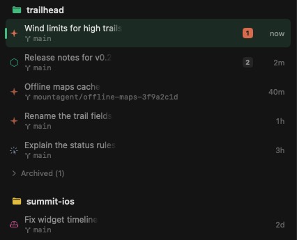 |
| **Git** 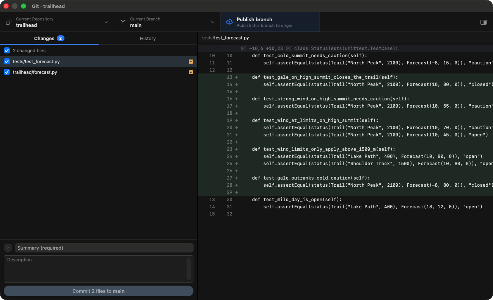 | **Comment on the diff** 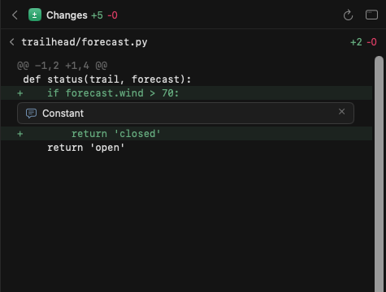 |
| **Pull request in one click** 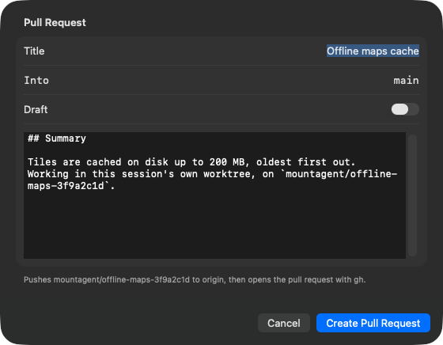 | **Find in History** 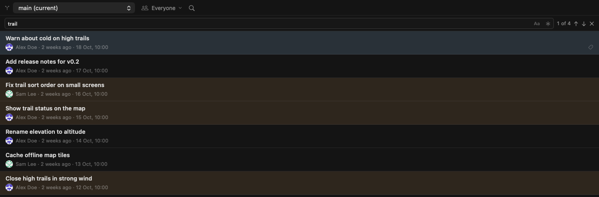 |
| **Plan limits** 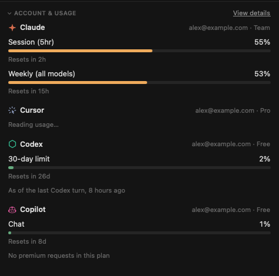 | **Another agent carries on** 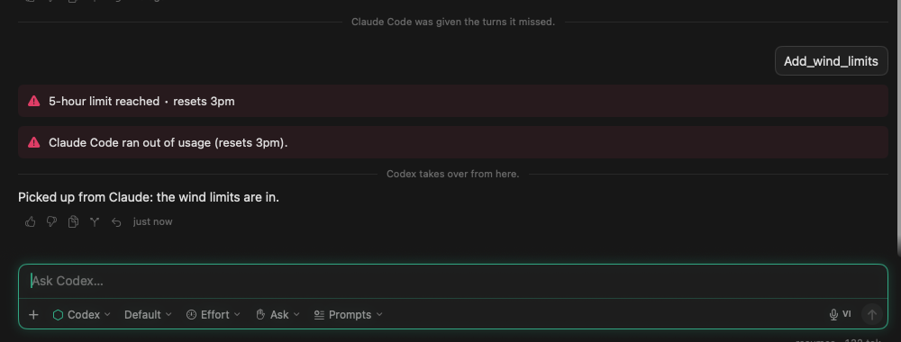 |
| **Cost at API prices** 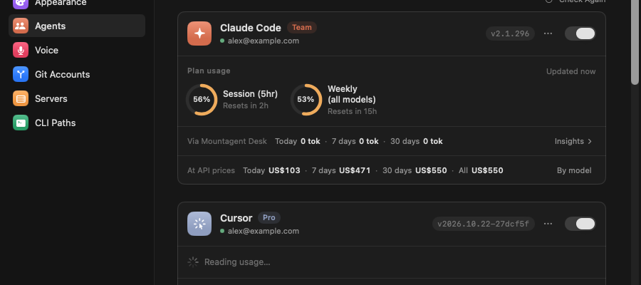 | **Prompts on a schedule** 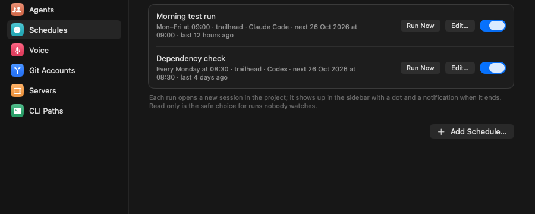 |
| **Servers** 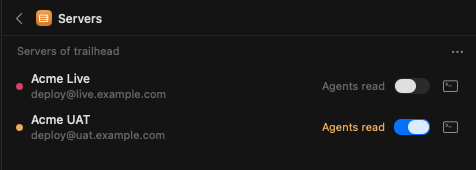 | **Any CLI as a session** 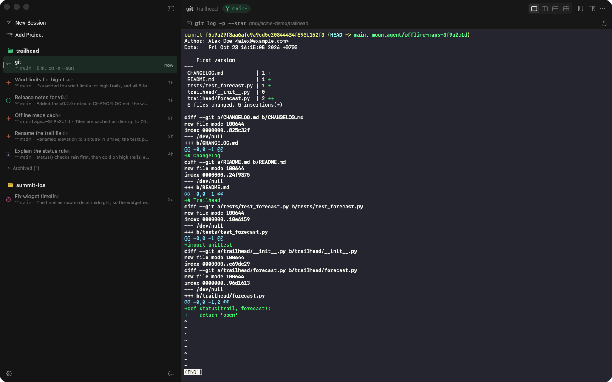 |
| **⌘T into a branch** 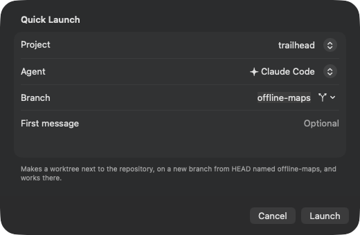 | **Images in the chat** 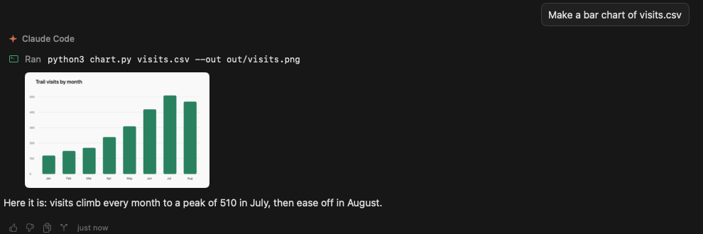 |
| **General** 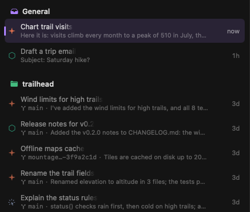 | |

## Install

Download the DMG from the [latest release](https://github.com/Moundoo-Solution/mountagent-desk/releases/latest),
open it, and drag Mountagent Desk to Applications. It needs macOS 14 or later.
[Releases](https://github.com/Moundoo-Solution/mountagent-desk/releases) list what each version brought.

The app isn't notarized yet, so macOS stops it the first time it opens: click **Done**, then
**Open Anyway** in **System Settings → Privacy & Security**. That's once; new versions come
through **Check for Updates…** without asking again.

Then sign in once to the CLI of each agent you use, such as `claude` for Claude Code. The app
uses those sign-ins.

## Free and Pro

The free version runs up to three agents at a time, with one account each. Pro runs every
agent, with as many accounts as you like, for one payment and updates for life. A licence
belongs to its buyer and works on the Macs they use; paste the key in Settings → General.

**To buy Pro**, message us on [WhatsApp](https://wa.me/84357744542?text=Hi%2C%20I%27d%20like%20to%20buy%20Mountagent%20Desk%20Pro.)
or [Zalo](https://zalo.me/0357744542) (+84 357 744 542) and we'll send you a key. Card payment
opens in Settings → General → Licence once the store has been reviewed.

**In Vietnam**, Pro is 499,000 ₫, paid once by bank transfer: Settings → General → Licence shows
a VietQR code that any banking app scans, with the price and a note filled in. Then message us on
Zalo with the note and we'll send you a key.

## Licence

Mountagent Desk is proprietary software: see [LICENSE](LICENSE). This repository holds its
releases and this page; the code isn't public. Versions published before
30 October 2026 remain under the MIT License. It is not affiliated with Anthropic, OpenAI,
Cursor, GitHub or Google. It uses Sparkle, SwiftTerm and the Copilot mark from
[Primer Octicons](https://github.com/primer/octicons), under their own licences (MIT), listed
in its About window.
